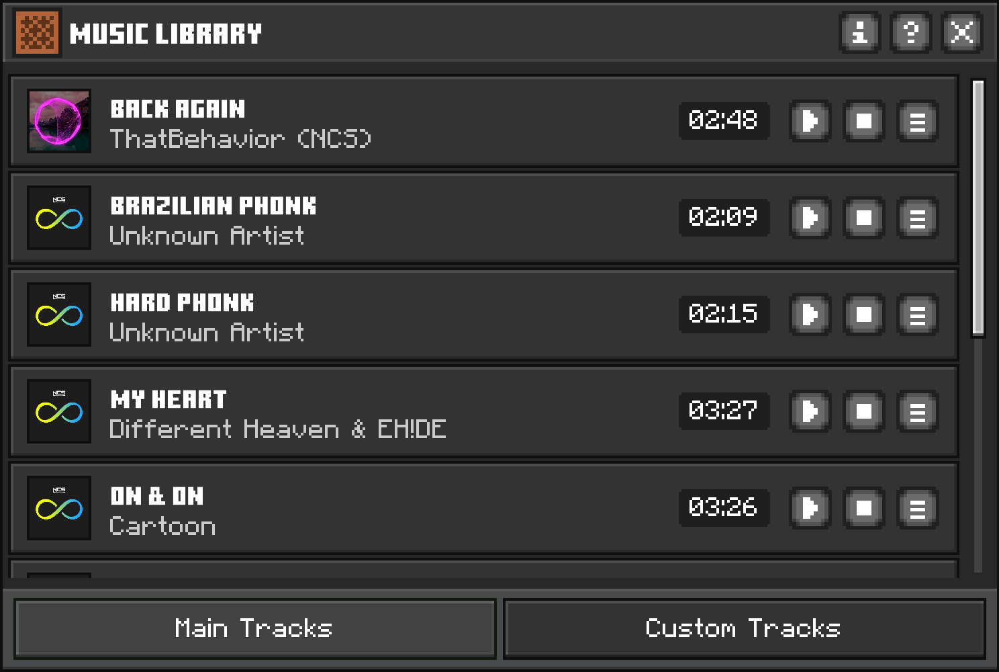

<div align="center">

# 🎵 Music UI

**A customizable music-player interface for Minecraft Bedrock Edition.**


</div>

Music UI is a resource pack by **AntonyPss** that adds a dedicated **Music Library** screen to Minecraft Bedrock Edition. Browse the bundled tracks, play or stop them with a click, and add your own `.ogg` songs, all in a Minecraft-inspired interface built entirely with JSON UI.

---

## ✨ Features

- 🎧 **Music Library screen** with two tabs: **Main Tracks** (bundled songs) and **Custom Tracks** (your own songs).
- 🃏 **Track cards** showing cover art, title, artist and duration, with **Play** and **Stop** buttons.
- 💬 **Localized hover tooltips** on the Play and Stop buttons.
- 🔍 **Details toggle** on every track that reveals its sound path.
- ℹ️ **About popup** with creator, pack version, last update and community link.
- 📁 **Audio Path Info popup** explaining where custom tracks go, the required format and the recommended sample rate.
- 🎼 **10 bundled tracks** ready to play.
- ➕ **Custom music support** using standard `.ogg` files.
- 🌍 **Languages:** English (US, UK), Spanish (Spain, Mexico) and Portuguese (Brazil).
- 📱 **Adaptive layout** for desktop and touch screens, with a smooth opening animation.

---

## 📸 Screenshot Preview


## 📋 Requirements

- **Minecraft Bedrock Edition 1.21.0 or newer** (the pack's `min_engine_version`).
- A platform and game version that load **custom UI resource packs**. Support can vary by platform and version, so test on your device.
- **Resource packs enabled** in your game settings.
- _Only for custom songs:_ a text editor and an audio converter (e.g. Audacity or FFmpeg) to produce `.ogg` (Vorbis) files.

> ⚠️ Other resource packs that modify UI files can conflict with Music UI. If something looks wrong, deactivate other UI packs and try again.

---

## 📦 Installation

1. Download **`Music-UI-v2.11.0.mcpack`** from the [Releases](https://github.com/AntonyPss/Music-Ui/releases) page.
2. Open the file with Minecraft Bedrock Edition. The game imports it automatically.
3. Go to **Settings → Global Resources → My Packs**.
4. Select **Music UI** and press **Activate**.
5. Restart the game and open the **Music Library** with the Music button added by the pack.

More detail, including manual installation: see [`IMPORT-MUSIC.md`](docs/IMPORT-MUSIC.md).

---

## 🎼 Importing Your Own Songs

1. **Convert** it to `.ogg` using tools like [Convertio](https://convertio.co/mp3-ogg/) or any online converter.
2. **Copy** it to `Music UI/sounds/music/my_song.ogg` (lowercase, no spaces).
3. **Register the sound** in `Music UI/sounds/sound_definitions.json`:
    ```json
    "music.my_song": {
        "category": "ui",
        "sounds": [
            {
                "name": "sounds/music/my_song",
                "stream": true,
                "volume": 1.0,
                "load_on_low_memory": true
            }
        ]
    }
    ```
4. **Add the track** inside `custom_list_content` in `Music UI/ui/music_list.json`, and set `"ignored": true` on the `empty_library` entry:
    ```json
    {
        "my_song@track_item": {
            "$songCover": "textures/covers/my_cover",
            "$songName": "My Favorite Song",
            "$songArtist": "Artist Name",
            "$songDuration": "03:45",
            "$songAudio": "music.my_song",
            "$songPath": "sounds/music/my_song"
        }
    }
    ```
5. **Reload** the game and open the **Custom Tracks** tab.

---

## 🗂️ Project Structure

Reference layout, based on the paths used by the UI files:

```text
Music UI/
├── manifest.json
├── pack_icon.png
├── texts/
│   ├── en_GB.lang
│   ├── en_US.lang
│   ├── es_ES.lang
│   ├── es_MX.lang
│   └── pt_BR.lang
├── ui/
│   ├── _global_variables.json    # Pack version, creator, last update, Discord
│   ├── _ui_defs.json             # Registers the Music UI files
│   ├── music_screen.json         # Screen, track card, popups, icons, tooltip
│   └── music_list.json           # Track list (main + custom)
├── sounds/
│   ├── sound_definitions.json    # Sound events: music.music_1, music.music_2, ...
│   └── music/                    # .ogg audio files
└── textures/
    ├── buttons/                  # Launcher button and tab buttons
    ├── covers/                   # Track cover art
    ├── icons/                    # UI icons
    └── ui/                       # Panels, bars, popups, tooltip border
```

Repository root: `README.md`, `LICENSE`, `CREDITS.md`, `IMPORT-MUSIC.md`.

---

## ❓ FAQ

**Which audio format does Music UI use?**
OGG Vorbis (`.ogg`). MP3 and WAV files must be converted first.

**I added a song but it does not play.**
Check that `$songAudio` matches the sound event name in `sound_definitions.json`, that `name` has no file extension, and that the file is a real `.ogg` (not a renamed `.mp3`).

**My track shows a wrong duration.**
`$songDuration` is a display label that you write manually in `MM:SS` format. It is not read from the audio file.

**What does the details button on each track do?**
It shows the track's sound path (`$songPath`) on the card.

**The pack does not appear or the UI does not change.**
Check that your game is version 1.21.0 or newer, that the pack is activated under _Global Resources_, and that no other UI pack is overriding the same files.

**Can I use other languages?**
The UI follows your game language. Included: English (US/UK), Spanish (Spain/Mexico) and Portuguese (Brazil).

**Can I use or redistribute Music UI commercially?**
No, not without written permission. See [`LICENSE`](LICENSE).

**Can I redistribute the bundled songs?**
The songs are not covered by the pack's license. They belong to their respective artists and labels. See [`CREDITS.md`](CREDITS.md) and check each source's terms before redistributing.

**How do I report a bug?**
Open an issue on [GitHub](https://github.com/AntonyPss/Music-Ui/issues) or ask in the Discord community.

---

## 📝 Changelog

### v2.11.0 — 2026-10-19

**Added**

- Sound path (`$songPath`) for all 10 bundled tracks, shown through the details toggle.
- Audio Path Info popup redesigned with icon rows for folder location, audio format and sample rate.
- Updated icon set with separate normal and hover states.

**Improved**

- Icon system rebuilt with explicit sizes and paired normal/hover icons.
- Details toggle uses a dedicated icon instead of an "X" that looked like a delete button.
- Custom tracks template simplified: new entries use `track_item`, which already includes default values.
- Metadata for _Back Again_ corrected (title and artist).
- Language keys standardized (`music.card.play.hover`, `music.card.stop.hover`).

**Fixed**

- Play and Stop tooltips now display their localized text.
- Spanish (Mexico) translation completed for the Audio Path Info popup.
- Removed an unused UI component (`media_hover_wrapper`).

> Earlier versions: see the [Releases](https://github.com/AntonyPss/Music-Ui/releases) page.

---

## 🔗 Useful Links

- **Releases:** https://github.com/AntonyPss/Music-Ui/releases
- **Issues:** https://github.com/AntonyPss/Music-Ui/issues
- **Repository:** https://github.com/AntonyPss/Music-Ui
- **Discord (Antony Labs):** https://discord.gg/kYDf4gadKw
- **Creator:** https://github.com/AntonyPss
- **NCS usage policy:** https://ncs.io/usage-policy
- **Bedrock Wiki (JSON UI reference):** https://wiki.bedrock.dev
- **Minecraft Creator docs:** https://learn.microsoft.com/en-us/minecraft/creator/

---

## 🙏 Credits & License

Created by **AntonyPss** as part of **Antony Labs**.

- Credits and music attributions: [`CREDITS.md`](CREDITS.md)
- License (non-commercial): [`LICENSE`](LICENSE)

© 2026 Antony Labs. All rights reserved except as granted in the license.

_Music UI is not an official Minecraft product. It is not approved by or associated with Mojang or Microsoft._
